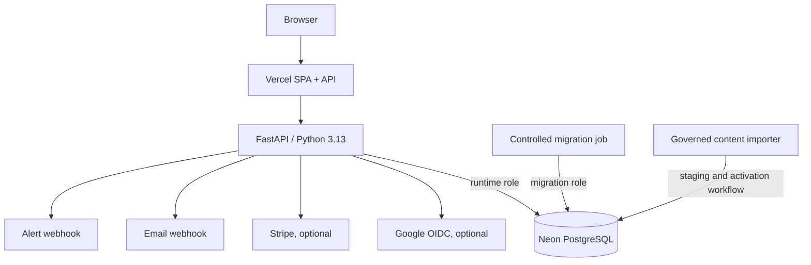

# C4: Containers

| Container | Technology | Responsibility | Data boundary |
| --- | --- | --- | --- |
| V26 learner application | Responsive vanilla JavaScript SPA, hash router, ES modules | Public discovery and authenticated candidate flows | No private bank package or authority-bearing state in browser storage |
| API application | Python 3.13, FastAPI, Pydantic on Vercel | Identity, curriculum, grading, question delivery, learning intelligence, entitlements, editorial, readiness and operations | Server-authoritative authorization and grading |
| Production database | Managed Neon PostgreSQL | Candidate state, immutable question versions, release membership, audit and operational state | Restricted runtime role; separate migration identity |
| Local/CI database | SQLite compatibility or PostgreSQL CI service | Development and reproducible checks | Never the production source of truth |
| Content package tooling | Build/import scripts and private deployment inputs | Validate provenance, quality, hashes, blueprint coverage and release eligibility | Build-time only; not in learner request path |
| External integrations | Google OIDC, Stripe, mail webhook, alert webhook | Optional identity, payment, delivery and notification | Enabled only through verified deployment configuration |

Production routes through Vercel to the FastAPI application and Neon. Application startup verifies schema compatibility; a separate approved job performs schema migrations. Question content is served from the active governed database release, not mounted files.

