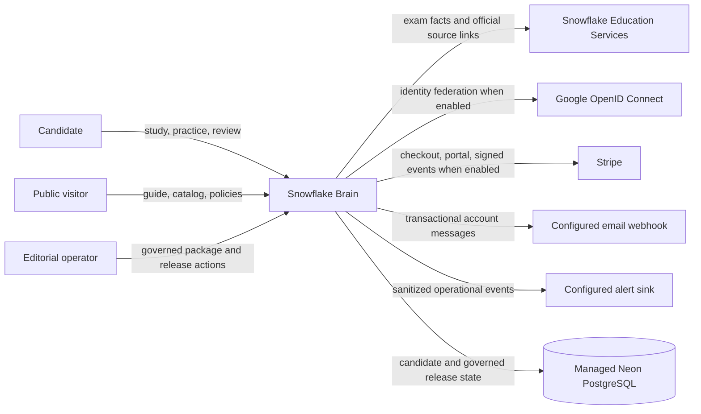

# C4: System Context

Snowflake Brain helps candidates answer “What should I study next?” by connecting an exam blueprint, written learning material, governed practice, build exercises, candidate history and explainable readiness. It supports certification preparation; Snowflake and its certification exams remain external authorities.

The production boundary is the existing Vercel application and managed Neon PostgreSQL. Local and CI may use SQLite. External identity, payment, mail and alert services are optional deployment integrations; their live configuration is not inferred from source code.

## Trust boundaries

- Public visitors receive discovery pages and verified exam facts only.
- Authenticated candidates receive their own learning state and questions served under access, quota and active-release rules.
- Editorial operators use server-checked roles to stage and govern content. Human/SME transitions require attributable approval evidence.
- CI/deployment jobs hold migration or provider credentials; request-serving code uses the restricted runtime database identity.
- Private source packages remain outside public Git, frontend assets, source maps and ordinary logs.

## Product decision

`NON_VIDEO_GA_WITH_VIDEO_BACKLOG`: written certification preparation is the GA boundary. Historical video/course-player requirements remain roadmap evidence and do not create runtime media surfaces.
