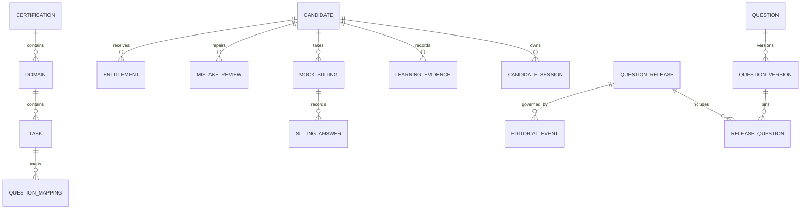

# Data Model and Authorities

The live schema is defined by application schema code and ordered migrations. This document describes domain relationships; it is not a replacement for those migrations.

Candidate identity and session ownership scope all private learning state. Learning evidence, mistakes, confidence, review schedules and mock results are candidate-owned and feed readiness; readiness is derived and persisted as a current evidence snapshot, not an independent authority. Historical sittings pin immutable question-version IDs, preserving their original content linkage after release changes.

Question releases reference immutable versions. Activation and rollback alter the active release pointer through audited server-side operations. Content quality/review evidence and release eligibility are separate from a question's presence in source files.

Entitlement state is server-owned and changes only through trusted billing transitions or explicit authorized administrative action. Raw provider events and idempotency keys protect replay handling.

See `docs/DATA_MODEL_V24.md`, `docs/QUESTION_BANK_BACKEND.md` and `docs/postgres-production-runbook.md` for schema and operational details.
